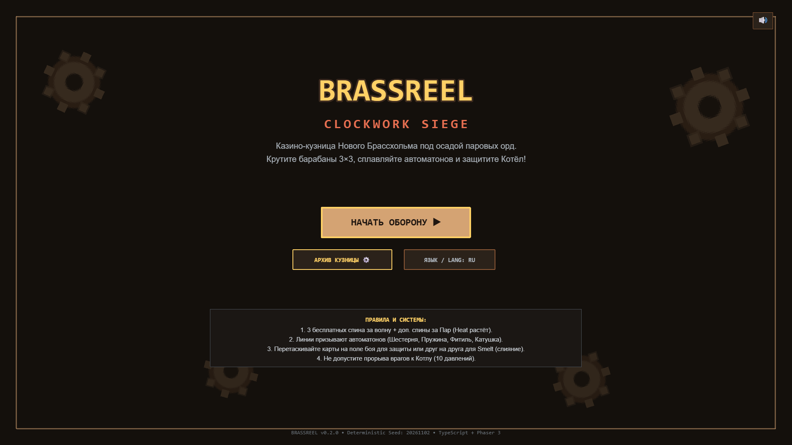
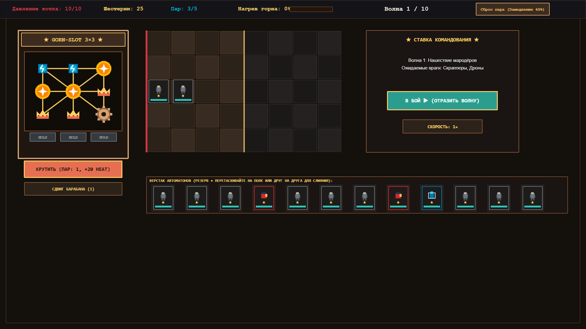
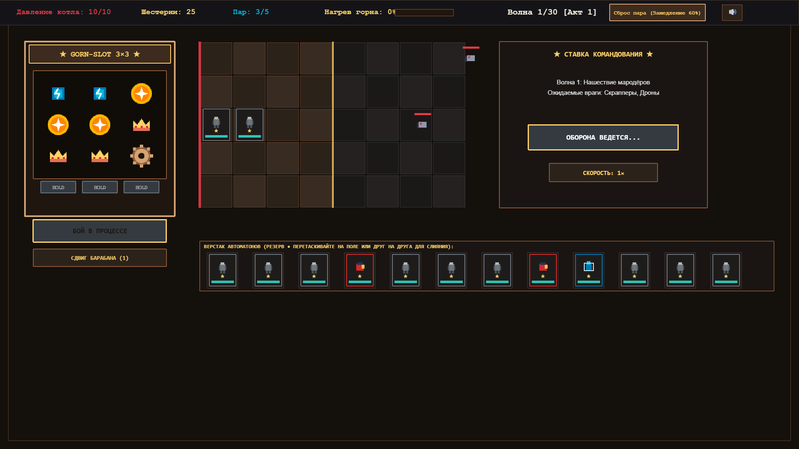
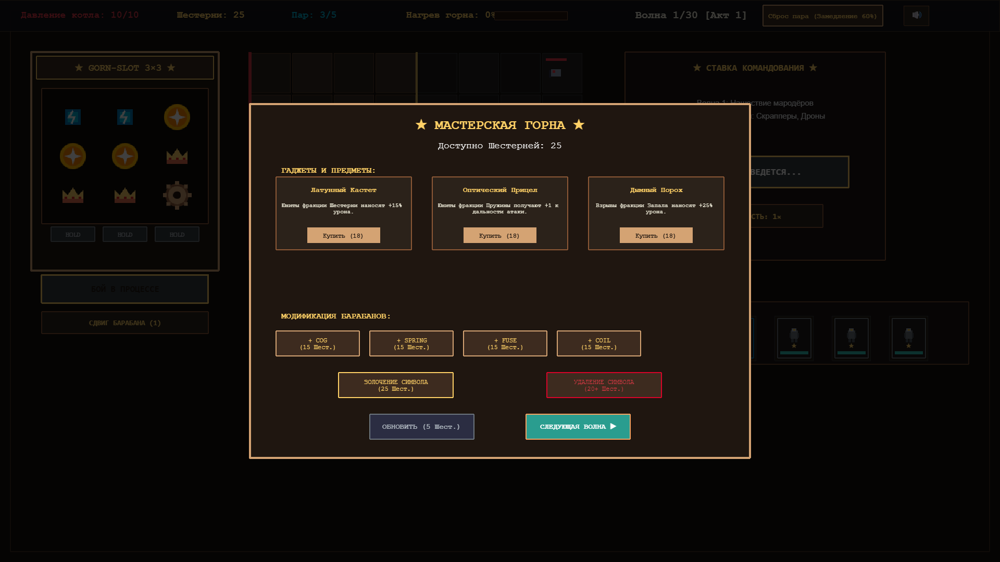
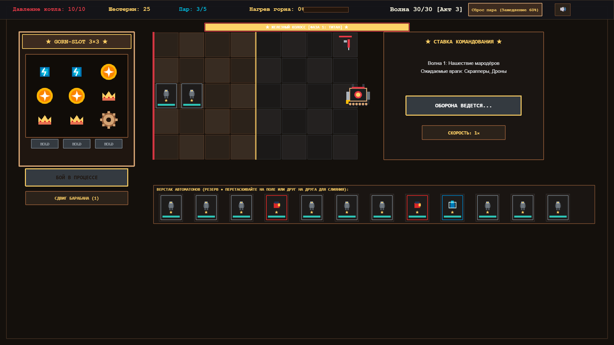
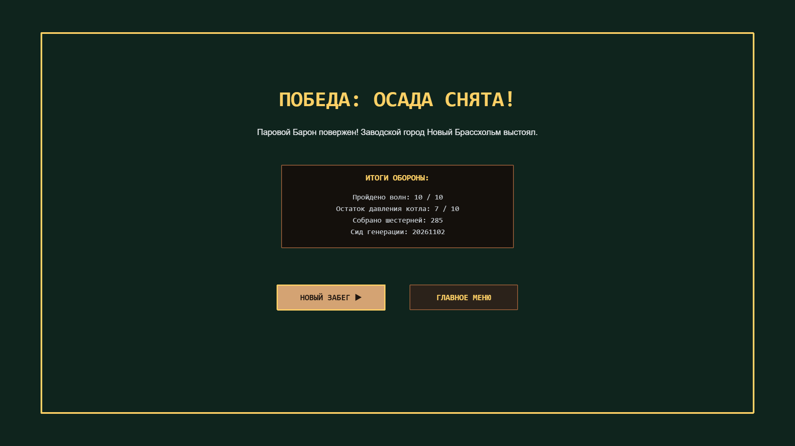
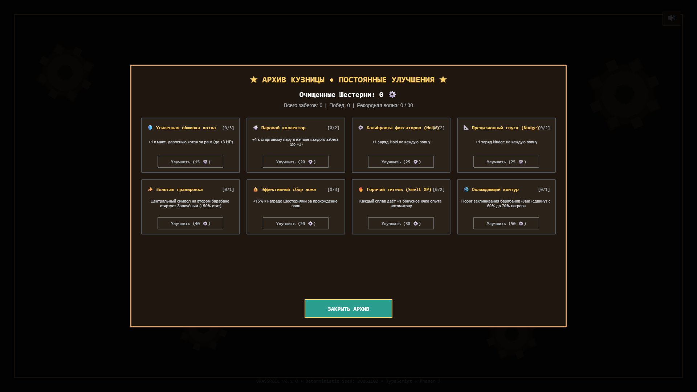
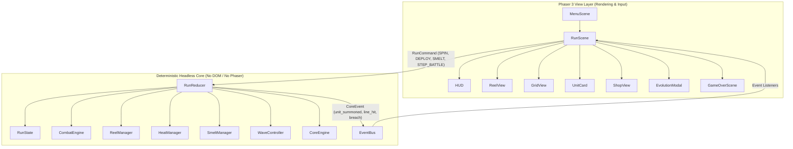

# BRASSREEL: Clockwork Siege

> **Roguelite auto-battler defense powered by a 3×3 slot machine forge.**  
> *Luck creates opportunities — smart builds forge victory.*

[](https://www.typescriptlang.org/)
[](https://phaser.io/)
[](https://vitest.dev/)
[](https://vitejs.dev/)

---

## ⚙️ About The Game

**BRASSREEL: Clockwork Siege** is a steampunk defense roguelite. You are the Mechanic of the last working
forge-casino of **New Brassholm**: spin a 3×3 slot machine to summon robots, place them on an 8×5 field
and hold **The Boiler** against 30 waves.

### Campaign «The Great Regulator»
The Steam Baron stole the city's Great Regulator and split it into three parts. Each act's boss keeps one:
**Flywheel** (Steam Baron, Brass Meadow), **Spiral** (Corrosion Empress, Rust Swamps) and **Heart**
(the Baron inside the Iron Colossus, Baron's Citadel). Story scenes with portraits, a radio line before every
wave, first-clear rewards, a chronicle to re-read scenes and four **threat levels** that unlock one by one.
Full script: [`docs/STORY.md`](docs/STORY.md).

### Core loop
- **Slot forge:** 8 paylines (3 rows, 3 columns, 2 diagonals); only **3 in a line** pays and summons a robot.
  `HOLD` keeps a reel, `NUDGE` shifts it. Paid spins add heat; above 60% the reels may jam.
- **Robots:** 4 lines × 7 robots + Scrap Bot + 3 legendaries. Merge two of the same line and level → level +1
  (up to ★5, +50% stats per level), evolution choice at ★3 and ★5. Every robot has a working combat quirk
  (shield auras, chain lightning, piercing bolts, stuns, time dilation…).
- **Field & reserve:** 5 robots on the field (skill tree and a gadget raise it), 10 reserve slots.
- **Auto-battle:** enemies grow stronger every wave; bosses have two phases; Emergency Valve slows the horde.
- **Workshop between waves:** 3 random gadgets (30 in total: permanent upgrades and consumables) with rising
  prices, a reel editor (pick a reel and a symbol: add, gild, remove) and the in-run **skill tree** (T).
- **Meta:** Forge Archive upgrades bought with refined cogs; campaign progress kept in the browser.

Rules in detail (Russian): [`docs/GAME_INFO.md`](docs/GAME_INFO.md).

---

## 📸 Screenshots

| 1. Main Menu (Casino-Forge) | 2. Prep Phase (3×3 Slot & Workbench) |
|:---:|:---:|
|  |  |

| 3. Battle Phase (8×5 Defense Grid) | 4. Foundry Workshop (Shop & Deck Edit) |
|:---:|:---:|
|  |  |

| 5. Boss Fight: The Steam Baron (Phase 2 Overheat) | 6. Victory / Defeat Screen |
|:---:|:---:|
|  |  |

| 7. Foundry Archives (Meta-Progression & Permanent Upgrades) |
|:---:|
|  |

---

## 🏛️ Architecture: Pure Core vs. Render Decoupling

The game architecture strictly separates the **pure deterministic logic core** from the **Phaser 3 UI presentation layer**:



- **SFC32 Multi-Stream PRNG:** Separate seed streams for `reel`, `combat`, `loot`, and `shop`. The same master seed always reproduces the exact same run bit-by-bit.
- **100% Procedural Pixel-Art:** All 48 sprites, symbols, tiles, and particles are synthesized programmatically on HTML5 canvas in [`src/fx/proceduralAssets.ts`](src/fx/proceduralAssets.ts). Zero external image dependencies.
- **i18n Dual-Language:** Full English and Russian support with dynamic runtime switching.

---

## 🚀 Quickstart & How To Play

### 🎮 Option 1: Native Windows Executable (.exe)
Simply double-click **`BRASSREEL.exe`** (or **`PLAY.bat`**) in the root directory!
- Runs instantly in a native, standalone, borderless 1920×1080 desktop window.
- Zero browser UI (no URL bars or tabs), full WebGL acceleration, and WebAudio SFX.
- Full keyboard shortcuts suite (Space, Enter, 1/2/3, Q/W/E, V, P, F11, M).

### 🌐 Option 2: Web Browser Local Server
```bash
npm install
npm run build
npm run preview
```
Then open `http://localhost:4173/` in any browser.

---

## 🛠️ Developer Commands
```bash
# Start Vite development server
npm run dev

# Run TypeScript strict typecheck
npm run typecheck

# Run Vitest test suite (141 tests)
npm test

# Run test coverage report
npm run test:coverage

# Balance: 1000 headless runs with the bot that plays by the current rules
npm run sim -- --runs 1000 --bot veteran --waves 30

# Rebuild docs/STORY.md from src/data/story.ts
npx tsx tools/docs/storyToMarkdown.ts
```

### Production Build & Desktop Wrappers
```bash
# Build production bundle with modular vendor chunks in /dist
npm run build

# Preview production build locally
npm run preview

# Desktop Steam Wrappers (see docs/RELEASE.md)
# Tauri 2: npx tauri build
# Electron: npx electron electron/main.cjs
```

---

## 🗺️ Project Structure

```
├── docs/
│   ├── GAME_INFO.md      # current rules, robots, workshop, campaign (Russian)
│   ├── STORY.md          # full campaign script (generated from src/data/story.ts)
│   ├── BALANCE.md        # balance model and simulator results (section 7 = current)
│   ├── WORK_LOG.md       # what was changed and why, open items
│   ├── claude_code.md    # notes for coding agents
│   └── GDD.md, ARCHITECTURE.md …  # original design documents (partly outdated)
├── src/
│   ├── core/             # deterministic game logic: reels, combat, smelt, skills, gadgets, campaign
│   ├── data/             # balance, robots, enemies, quirks, gadgets, story, i18n texts
│   ├── art/              # procedural pixel-art forge and UI frames
│   ├── ui/               # HUD, slot, shop, skill tree, dialogue and campaign windows
│   └── scenes/           # Phaser scenes: Boot, Menu, Run, GameOver
├── tests/                # Vitest tests
└── tools/
    ├── sim/              # headless simulator and bots (VeteranBot)
    ├── qa/               # screenshots, sprite sheets, playability check
    └── docs/             # docs generators
```

---

## 📜 Milestones & Roadmap

- [x] **M0–M5:** engine, simulator, playable slice, 30 waves with 3 bosses, meta-progression, release wrappers.
- [x] **Visual overhaul:** procedural robots and enemies, act backdrops, brass UI, readable Rubik font.
- [x] **Rules rework:** merge levels ★1–★5, field limit, skill tree, place robots anywhere outside battle.
- [x] **Balance pass:** endless-battle fixes, enemy growth per wave, VeteranBot simulator.
- [x] **Workshop:** 30 working gadgets, random shelf, reel editor; all robot quirks work in battle.
- [x] **Campaign «The Great Regulator»:** story scenes, goal, threat levels.
- [ ] Jackpot choice between the three legendaries.
- [ ] English campaign script.

---

## 📄 License

Original project and procedural assets. MIT License.


## Играть онлайн

https://fasty1013.github.io/brassreel-clockwork-siege/

Документация на русском: правила — `docs/GAME_INFO.md`, сюжет — `docs/STORY.md`,
баланс — `docs/BALANCE.md`, журнал работ — `docs/WORK_LOG.md`.

Сайт обновляется автоматически при каждой отправке в ветку `main` (см. `.github/workflows/pages.yml`).
