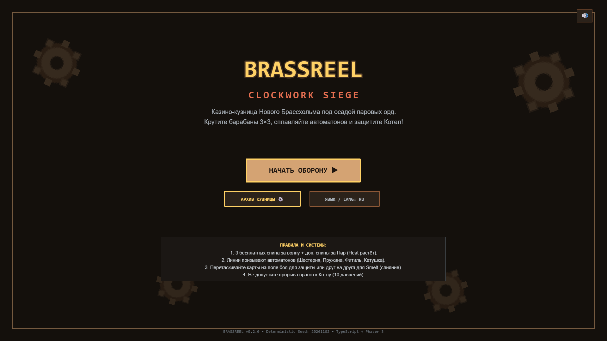
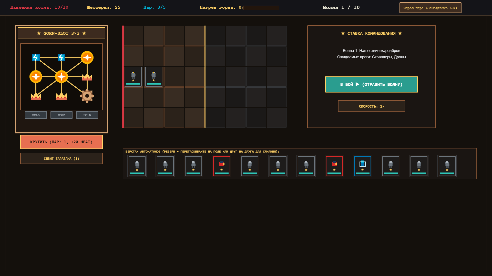
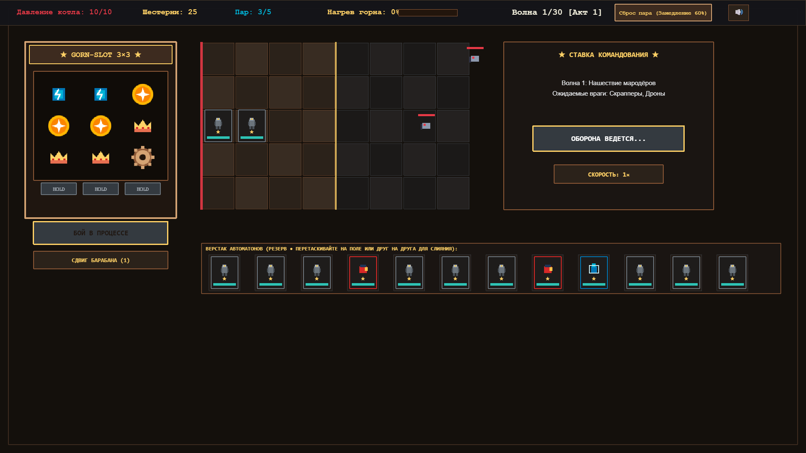
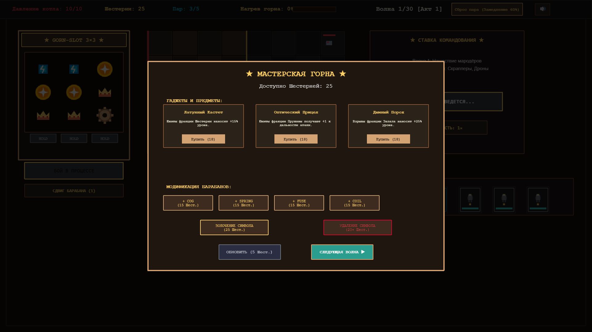
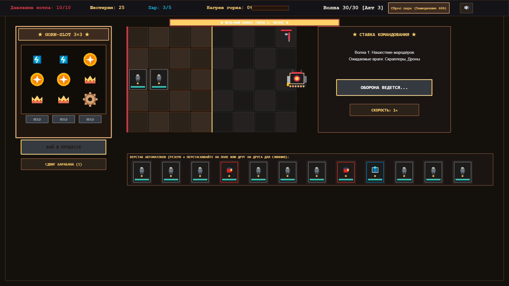
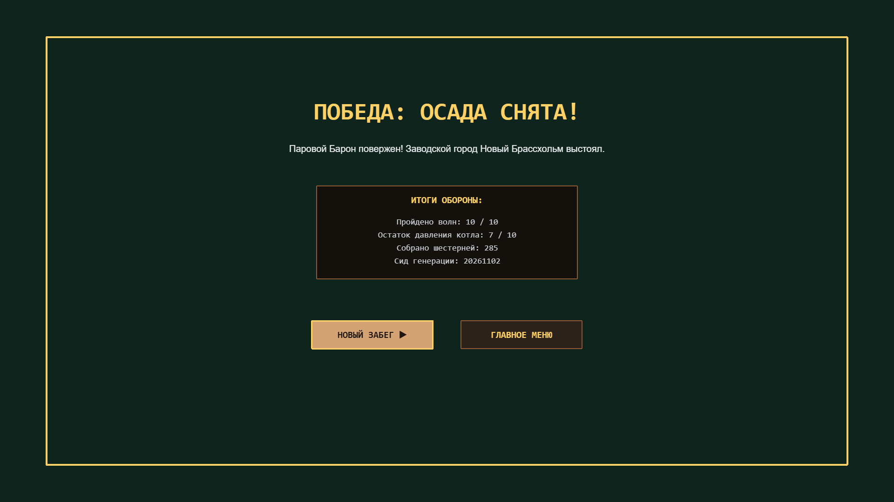
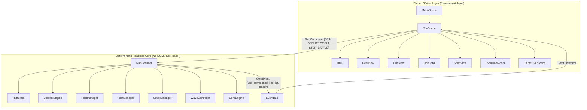

# BRASSREEL: Clockwork Siege

> **Roguelite auto-battler defense powered by a 3×3 slot machine forge.**  
> *Luck creates opportunities — smart builds forge victory.*

[](https://www.typescriptlang.org/)
[](https://phaser.io/)
[](https://vitest.dev/)
[](https://vitejs.dev/)

---

## ⚙️ About The Game

**BRASSREEL: Clockwork Siege** is a dark brass and clockwork steampunk defense roguelite. You are the engineer-operator of a casino-mechanized forge defending **The Boiler of New Brassholm** (10 pressure HP) against relentless hordes of rust automatons and scrap marauders.

Instead of traditional tower placement, your defenders are stamped and summoned through a **customizable 3×3 slot machine forge**:
- **3 customizable reel strips:** Add faction symbols, remove weak symbols (*Reel Thinning*), and gild symbols (*Gilded +50% stats*).
- **8 paylines (3 rows, 3 columns, 2 diagonals):**
  - **3 of a kind** summons Tier 1 faction defenders (Cog Tanks, Spring Archers, Fuse Sappers, Coil Sparkers).
  - **2 of a kind** summons Tier 0 Scrap Bots (fuel for the Smelt crucible).
  - **3 Crowns** triggers **JACKPOT**: choice of 1 of 3 legendary *Grand Automatons*!
- **Skill over pure RNG:** `HOLD` lock reels for the next spin; `NUDGE` bump reels up or down.
- **Push-Your-Luck Heat Gauge:** Extra spins increase furnace Heat (0–100%) and Crown/Wild weights, but risk **Jam** malfunctions.
- **Smelt Crucible (Fusion & Evolution):** Drag defenders onto each other to absorb and evolve (★1 → ★2 at 3 XP, ★2 → ★3 at 6 XP) with 2 branching archetypes per tier (4 final forms per faction), plus inheritance of rolled modifiers.
- **Real-Time Auto-Battle (8×5 discrete grid):** 1×/2×/4× battle speed, projectile trajectories, status effects (Burn, Shock, Stun, Slow, Barrier), and **Emergency Valve** slow-motion release.
- **Act 1 Boss:** *The Steam Baron* with a Phase 2 Overheat transformation.

---

## 📸 Screenshots

| 1. Main Menu (Casino-Forge) | 2. Prep Phase (3×3 Slot & Workbench) |
|:---:|:---:|
|  |  |

| 3. Battle Phase (8×5 Defense Grid) | 4. Foundry Workshop (Shop & Deck Edit) |
|:---:|:---:|
|  |  |

| 5. Boss Fight: The Steam Baron (Phase 2 Overheat) | 6. Victory Screen |
|:---:|:---:|
|  |  |

---

## 🏛️ Architecture: Pure Core vs. Render Decoupling

The game architecture strictly separates the **pure deterministic logic core** from the **Phaser 3 UI presentation layer**:



- **SFC32 Multi-Stream PRNG:** Separate seed streams for `reel`, `combat`, `loot`, and `shop`. The same master seed always reproduces the exact same run bit-by-bit.
- **100% Procedural Pixel-Art:** All 48 sprites, symbols, tiles, and particles are synthesized programmatically on HTML5 canvas in [`src/fx/proceduralAssets.ts`](src/fx/proceduralAssets.ts). Zero external image dependencies.
- **i18n Dual-Language:** Full English and Russian support with dynamic runtime switching.

---

## 🚀 Quickstart & Commands

### Prerequisites
- [Node.js](https://nodejs.org/) (v20+ recommended)
- npm / yarn / pnpm

### Installation
```bash
git clone https://github.com/Fasty1013/brassreel-clockwork-siege.git
cd brassreel-clockwork-siege
npm install
```

### Development
```bash
# Start Vite development server
npm run dev

# Run TypeScript strict typecheck
npm run typecheck

# Run Vitest test suite (58/58 unit & integration tests)
npm test

# Run test coverage report
npm run test:coverage
```

### Headless Simulation (Node.js CLI)
Simulate thousands of complete 10-wave runs in seconds with autonomous AI bot policies:
```bash
# Run 1,000 headless runs with SmartBot
npm run sim

# Custom simulation flags
npx tsx tools/sim/runner.ts --runs 5000 --bot SmartBot --seed CUSTOM_SEED
```

### Automated E2E Browser Playtest (Puppeteer)
Runs headless Chrome through the complete gameplay loop (Menu → Spins → Deployment → Battle → Shop → Wave 10 Boss → Victory) and captures fresh screenshots:
```bash
npm run playtest
```

### Production Build
```bash
npm run build
npm run preview
```

---

## 🗺️ Project Structure

```
├── .agent/               # Agent team governance, rules, and workflows
├── docs/                 # Game Design Document (GDD), Architecture, Balance model
│   ├── ARCHITECTURE.md   # Core design patterns, state management, PRNG
│   ├── GDD.md            # Complete game design document
│   ├── BALANCE.md        # Mathematical balance, odds, and bot targets
│   ├── HANDOFF.md        # Inter-agent task board and handoff log
│   └── screenshots/      # High-resolution gameplay screenshots
├── src/
│   ├── core/             # Pure deterministic engine (PRNG, reels, combat, state)
│   ├── data/             # Data-driven tables (units, mods, cores, gadgets, enemies)
│   │   ├── i18n/         # Localization dictionaries (en.json, ru.json)
│   │   └── schemas/      # Zod validation schemas
│   ├── fx/               # Procedural pixel-art Canvas asset generator
│   ├── scenes/           # Phaser 3 scenes (Boot, Menu, Run, GameOver)
│   └── ui/               # Interactive UI components (HUD, ReelView, GridView, ShopView)
├── tests/                # Vitest unit & integration tests, E2E Puppeteer scripts
└── tools/sim/            # Node.js headless simulator and autonomous bot policies
```

---

## 📜 Milestones & Roadmap

- [x] **M0: Planning & Architectural Foundations** — GDD, Balance model, governance rules.
- [x] **M1: Pure Engine & Headless Simulator** — 90.99% coverage, 58/58 tests, 1,000 runs in 1.82s.
- [x] **M2: Playable Vertical Slice (Phaser 3)** — Full 10-wave playable loop, procedural Canvas art, 3×3 slot forge, E2E browser verification.
- [ ] **M3: Meta-Progression, Audio & Polish** — WebAudio procedural SFX, Foundry Archives (`localStorage`), Acts 2 & 3.
- [ ] **M4: QA Hardening & Balance Tuning** — 10,000 headless runs, difficulty curves.
- [ ] **M5: Steam / Tauri Release Packaging** — Desktop wrapper readiness.

---

## 📄 License

Original project and procedural assets. MIT License.
