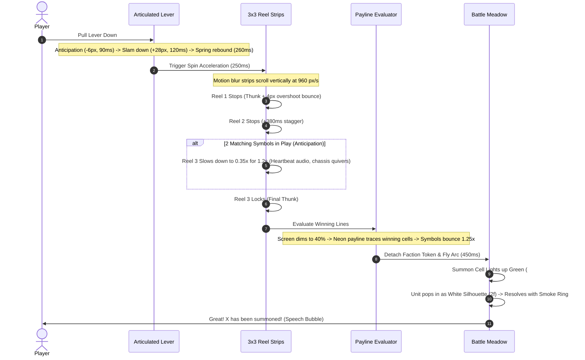

# BRASSREEL: Clockwork Siege — Official Animation Bible

**Version:** 1.0.0 (Visual Overhaul — Planning P0)  
**Lead Discipline:** Animator & VFX Engineer  
**Core Standard:** 8–12 FPS Authentic Frame-by-Frame 2D Pixel Animation with Integer Pixel Movement  
**Data-Driven Invariant:** Zero hardcoded animation timings in game logic. All values reside in `/data/animation/*.json`.

---

## 1. Core Principles of Steampunk Pixel Animation

1. **Anticipation Before Action:**
   Every physical action starts with an opposing preparatory motion:
   - Melee attacks: character draws backward 2–4 px before lunging forward.
   - Slot lever: handle kicks upward 6 px before slamming downward.
   - Jump-hop walk: legs compress (squash 0.85×) before propelling the torso 2 px upward.
2. **Follow-Through & Overshoot:**
   Mechanical masses never stop instantly:
   - Slot reels overshoot their rest position by 3–4 px, then bounce back into alignment (`Back.easeOut`).
   - Weapon strikes carry past the contact point into a full swing arc before snapping back to guard.
3. **Secondary Motion & Vitality:**
   Even idle automatons display mechanical life:
   - Puffs of white steam from exhaust pipes on odd idle frames.
   - Rattling chains and dangling wires on the slot cabinet.
   - Spinning cogs on unit pauldrons.
   - Randomized phase offsets: never let all units on the field breathe in unison.
4. **Frame-Event Synchronization:**
   Audio, visual FX, and combat logic are strictly synchronized to key animation frames:
   - Frame 2 of melee attack -> Spawns white swoosh arc, plays slash SFX, applies damage.
   - Frame 2 of ranged attack -> Releases arrow projectile, emits barrel smoke.
   - Frame 2 of walk cycle -> Drops dust particle under left foot.

---

## 2. Unit Animation States & Timing Profiles

All standard combatants (units and enemies) implement the 6 fundamental animation states defined in [`/data/animation/units.json`](../data/animation/units.json):

```
+-----------------------------------------------------------------------------------------------+
| STATE        | FRAMES | FPS  | DURATION | CHOREOGRAPHY & VISUAL MOTIFS                        |
+--------------+--------+------+----------+-----------------------------------------------------+
| idle         | 4 f    | 8    | 500 ms   | Pneumatic breathing, subtle torso expand, steam wisp|
| move         | 6 f    | 10   | 600 ms   | 2px jump-hop walk, ground shadow scales, dust puffs |
| attack       | 5 f    | 12   | 416 ms   | Anticipation draw-back -> Strike lunge -> Recover   |
| hit          | 2 f    | 12   | 166 ms   | Pure white silhouette tint, 3px knockback, sparks   |
| death        | 6 f    | 12   | 500 ms   | Flash -> 8 flying scrap shards with gravity & bounce|
| spawn        | 5 f    | 12   | 416 ms   | Green cell glow -> White silhouette -> Pop & smoke  |
+-----------------------------------------------------------------------------------------------+
```

### 2.1 The Signature "Jump-Hop" Movement
As seen in the reference video, characters do not skate across the ground; they have a joyful, retro jump-hop:
- **Frame 0 (Contact):** Neutral stance, feet planted, shadow 1.0×.
- **Frame 1 (Compress):** Torso drops 1 px, knees bend, shadow expands 1.1×.
- **Frame 2 (Ascend):** Torso hops 2 px upward, left foot kicks forward, shadow shrinks 0.8×, dust puff spawns.
- **Frame 3 (Peak):** Torso at peak (+2 px), legs trailing in air.
- **Frame 4 (Descend):** Torso lands, right foot plants, shadow expands 1.05×, dust puff right.
- **Frame 5 (Recover):** Weight resets to neutral.

### 2.2 Melee Strike Choreography
- **Frames 0–1 (Anticipation):** Torso tilts backward -2 px, weapon pulled behind shoulder, glint on blade tip.
- **Frame 2 (Impact):** Torso lunges forward +6 px, white crescent slash arc spawns in front of unit, screen micro-freeze 40 ms on crit.
- **Frames 3–4 (Recovery):** Weapon inertia carries through, unit steps back to neutral battle stance.

### 2.3 Ranged Attack Choreography
- **Frames 0–1 (Tension):** Bowstring pulled taut or sniper rifle brought to eye, eye visor gleams.
- **Frame 2 (Release):** High-speed projectile spawns with smoke puff, unit experiences -5 px backward kickback.
- **Frames 3–4 (Chamber):** Hand reaches into gear quiver, bowstring vibrations settle.

---

## 3. Slot Machine Sequence Choreography

The slot machine presentation follows the exact timing curve defined in [`/data/animation/slot.json`](../data/animation/slot.json):



---

## 4. Combat Juice & Particle Profiles

Refer to [`/data/animation/combat.json`](../data/animation/combat.json) for runtime parameters:

1. **Whiteout Hit-Flash:**
   - Any damage received immediately triggers `setTintFill(0xffffff)` for exactly 70 ms.
   - Followed by 3px horizontal knockback and emission of 4–6 orange friction spark particles.
2. **Floating Damage Numbers:**
   - Normal hits: 8 px white pixel text with 1px black drop-shadow, floating 12 px upward over 650 ms.
   - Critical hits: 10 px gold `#ffd166` text with squash-bounce overshoot (1.25×), floating 18 px upward over 850 ms.
3. **Scrap Dissolve on Death:**
   - Upon HP reaching 0, unit flashes white, then bursts into 8 discrete scrap chunk sprites (cogs, plate shards, screws) that spray outward with physics gravity ($480 \text{ px/s}^2$) and ground bounce.
   - A billow of gray factory steam dissipates over 300 ms.
   - Total corpse clear time: exactly 400 ms (keeping the battlefield crisp and uncluttered).
4. **Jackpot Show (3 Crowns):**
   - Game freezes for 150 ms hit-stop.
   - World enters 0.3× slow-motion for 600 ms.
   - Blinding white screen flash.
   - Shower of 160+ golden coin particles pouring from top of the screen and bouncing off the slot shelf.
   - Grand Automaton cards flip with 3D-card illusion and live idle animation loop.

