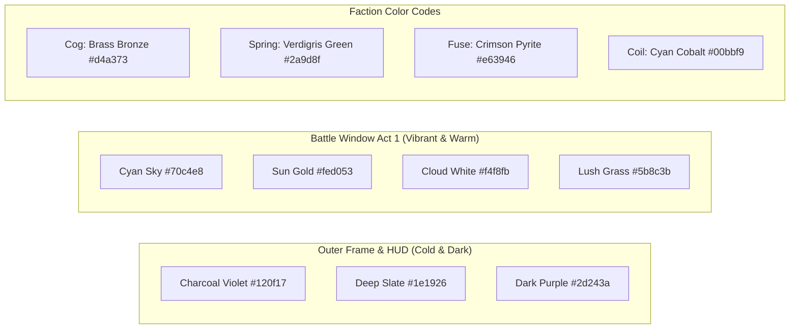

# BRASSREEL: Clockwork Siege — Official Art Bible

**Version:** 1.0.0 (Visual Overhaul — Planning P0)  
**Lead Discipline:** Art Director & Environment/UI Pixel Artist  
**Aesthetic Anchor:** Authentic 16-bit Steampunk Pixel Art (Reference: *Slotbound* `/docs/reference/gameplay.mp4`)  
**Canvas Resolution:** Native 640×360 px, integer ×3 nearest-neighbor scaling to 1920×1080 px (`Phaser.Scale.FIT`, `pixelArt: true`, `roundPixels: true`).

---

## 1. Color Palettes & Contrast Philosophy

The game's visual hierarchy is built on a sharp, intentional contrast:
- **Frame & Outer Shell:** Cold, dark, moody industrial iron and purple-slate (`#120f17`, `#1e1926`, `#2d243a`). Keeps user attention focused on the action.
- **Battle Window:** Warm, inviting, vibrant storybook landscape. Daylight blues, golden sunshine, lush 3-tier greens, bright characters.
- **Slot Machine:** Mechanical brass, copper, oiled iron, and paper-grey reel strips.



### 1.1 Master System Palette (32 Colors)
Based on classic 16-bit arcade palettes with bespoke steampunk brass additions:

| Hex Code | Color Name | Role / Usage |
|---|---|---|
| `#0b090f` | Void Black | Outermost canvas border, darkest contours, pupil dots |
| `#15121b` | Iron Charcoal | Frame backdrops, slot machine chassis dark base |
| `#231d2c` | Slate Purple | Slot cabinet bevels, shelf shading, UI panel backdrops |
| `#393047` | Muted Violet | UI 9-slice borders, speech bubble backgrounds |
| `#534764` | Lilac Grey | Neutral button outlines, disabled states, metal reflections |
| `#7b6b8d` | Lavender Smoke | Cold steam clouds, metal specular highlights |
| `#b8a9c9` | Pale Mist | Light reflections, text highlights, paper shadows |
| `#e7e0ef` | Parchment Silk | Reel strip paper surface, speech bubble text, whiteout flash |
| `#3a2215` | Dark Oiled Iron | Machinery gears, gun barrels, anvil bases |
| `#5c381e` | Tarnished Bronze | Cog faction secondary armor, wood handles |
| `#8c5836` | Antique Brass | Faction Cog base tone, chassis brackets |
| `#b57647` | Polished Brass | Primary metal armor, gear teeth, HUD cartouches |
| `#d4a373` | Gilded Gold | Weapon edges, button borders, ★3 star icons |
| `#ffd166` | Radiant Spark | High-voltage spark centers, jackpot coin glints, active buttons |
| `#1b4332` | Forest Shadow | Tree trunk shadows, dark foliage layer |
| `#2d6a4f` | Deep Green | Mid-tone tree leaves, dark grass boundary |
| `#40916c` | Meadow Grass | Primary battlefield ground, lush foliage |
| `#52b788` | Spring Leaf | Faction Spring base tone, arrow fletching |
| `#74c69d` | Emerald Lime | Spring crit flashes, summon cell glow |
| `#b5e48c` | Pale Sprout | Summon cell highlight surface, spring sparkles |
| `#4a0e17` | Dried Blood | Deep shadow on explosives, enemy eyes |
| `#780000` | Rust Burgundy | Fuse faction secondary tone, leather straps |
| `#c1121f` | Pyrite Red | Primary red for Fuse bombs, lever ball knob, danger alerts |
| `#e63946` | Blazing Ember | Explosion flashes, boiler breach alert, damage numbers |
| `#f77f00` | Furnace Flame | Heat gauge high-warning, burning fuse sparks |
| `#fcbf49` | Core Fire | Heat gauge medium, explosion core |
| `#03045e` | Deep Abyss | Coil faction dark shading, deep night sky |
| `#023e8a` | Midnight Cobalt | Leyden jar casing, robot eye lenses |
| `#0077b6` | Electric Blue | Faction Coil primary armor, water reflections |
| `#00b4d8` | Arc Cyan | Lightning bolts, Tesla discharge plasma |
| `#90e0ef` | Plasma White | Coil attack core, electric sparks |
| `#caf0f8` | Pure Starlight | White projectile trails, critical hit glints |

---

### 1.2 Sub-Palettes by Domain
1. **UI & Chassis Palette (≤ 24 colors):**
   `#0b090f`, `#15121b`, `#231d2c`, `#393047`, `#534764`, `#7b6b8d`, `#e7e0ef`, `#3a2215`, `#8c5836`, `#b57647`, `#d4a373`, `#ffd166`, `#c1121f`, `#e63946`, `#0077b6`, `#00b4d8`, `#52b788`.
2. **Battle Window Palette (Act 1: Daylight — ≤ 32 colors):**
   Sky: `#70c4e8`, `#a0d8ef`, `#eef6fc`. Sun: `#ffd166`, `#fed053`, `#f4a261`. Clouds: `#f4f8fb`, `#d8e2ec`, `#9cb3c9`. Trees & Meadow: `#1b4332`, `#2d6a4f`, `#40916c`, `#52b788`, `#74c69d`, `#b5e48c`, `#2b1e16` (soil/rails).
3. **Unit Palette Budget (≤ 16 colors per character):**
   - 1 outline color (darkest tone).
   - 3–4 skin/chassis tones (brass/steel/wood).
   - 2–3 faction secondary tones (green, red, cyan, or bronze).
   - 2 weapon metal tones (iron + silver edge).
   - 1 ocular glow color (yellow/cyan/red).
   - 1 shadow color (translucent black on grass).

---

## 2. Technical Pixel-Art Rules

```
+-----------------------------------------------------------------------------------+
|  1. RESOLUTION GRIDS:                                                             |
|     - Sprites & UI: 640×360 canvas (each native pixel = 3×3 on 1080p screen)      |
|     - Window Backdrop: 320×180 canvas (each native pixel = 6×6 on 1080p screen)   |
|                                                                                   |
|  2. CONTOUR RULE:                                                                 |
|     - 1px dark contour around all sprites. Never pure #000000.                    |
|     - Use #15121b for iron, #3a2215 for brass, #1b4332 for green, etc.           |
|                                                                                   |
|  3. SHADING & LIGHTING:                                                           |
|     - Flat cell-shading: exactly 3 to 4 tonal steps per material.                 |
|     - Light source: Top-Left (10 o'clock position) across the entire screen.      |
|     - No bilinear blur, no feathered gradients, no anti-aliased brush edges.      |
|                                                                                   |
|  4. INTEGER POSITIONING:                                                          |
|     - Sprite X and Y coordinates MUST be rounded to integer values: Math.round()  |
|     - No sub-pixel rendering (avoids pixel shimmer and blurry edges).             |
|                                                                                   |
|  5. DISCRETE SQUASH & STRETCH:                                                    |
|     - No smooth float scaling (e.g. scale 1.074x is forbidden).                   |
|     - Scaling allowed ONLY in fixed discrete steps: 0.75, 1.0, 1.25.              |
|     - Preferred: Draw dedicated squash & stretch frames in the sprite sheet.      |
+-----------------------------------------------------------------------------------+
```

---

## 3. Entity Sizing & Silhouette Guidelines

| Entity Type | Frame Canvas Size | Actual Character Height | Silhouette Anchor | Ocular / Focal Point |
|---|:---:|:---:|---|---|
| **Tier 0 (Scrap Bot)** | 32×32 px | 22 px | Asymmetric, hunched, thin limbs | Single flickering yellow lens |
| **Tier 1 (Base Defenders)** | 32×32 px | 24–26 px | Readable helmet, distinct weapon held out | Bright slit visor or goggles |
| **Tier 2 (Evolved Automatons)** | 36×36 px | 28–30 px | Broader pauldrons, distinct secondary gear | Twin ocular glow + steam vents |
| **Tier 3 (Heavy Titans)** | 48×48 px | 38–42 px | Imposing bulk, wide stance, smokestacks | Radiant core engine glow |
| **Grand Automatons (Legendary)** | 56×56 px | 48–52 px | Mythic brass monoliths, ornate crests | Multi-lens astrolabe array |
| **Enemies (Act 1 Mobs)** | 32×32 px | 22–26 px | Menacing forward lean, rust-cleavers | Crimson/orange optical sensors |
| **Boss: Steam Baron** | 64×64 px | 52 px | Locomotive boiler hull, top hat, Gatling | Glowing red furnace mouthplate |
| **Boss: Iron Colossus** | 96×96 px | 84 px | Skyscraper iron fortress, dual smokestacks | Exposed white-hot reactor core |
| **Reel Symbols** | 28×28 px | 24×24 px | Bold iconic shape filling 85% of frame | High-contrast central motif |

---

## 4. UI Design Tokens & 9-Slice Slicing

All UI windows, dialog boxes, and buttons use authentic **9-slice pixel textures**:

### 4.1 Battle Window Frame (`ui_window_parchment`)
- **Native Dimensions:** 9-slice grid with 8px corners, 4px edges.
- **Palette:** `#f4ecd8` (parchment face), `#d4a373` (brass rim), `#3a2215` (inner shadow), `#0b090f` (1px contour).
- **Rivet Accents:** 3×3 px dark brass circles placed every 32 native px along the border.

### 4.2 Button States (`ui_btn_round_skull` / `ui_btn_nudge` / `ui_btn_pill`)
- **Normal:** 1px highlight top/left, 2px shadow bottom/right.
- **Hover:** Highlight brightens to `#ffd166`, 1px upward bounce.
- **Pressed:** Frame shifts 1px down and 1px right; shadow shrinks to 1px; interior drops into dark shade.
- **Disabled:** Monochromatic slate grey `#534764`, 0.6 alpha, no highlights.

### 4.3 Guide Dialogue Bubble (`ui_speech_bubble`)
- **Background:** Rounded rectangle in deep mulberry `#393047` with 1px border `#d4a373`.
- **Tail:** Triangular 5×4 px pointer directed toward Foreman Cogsworth's niche.
- **Text:** 8px bitmap pixel font in `#f4ecd8` with `#ffd166` highlighted keywords.
- **Prompt:** Flashing prompt text `Click to continue` in `#b8a9c9` at bottom-center.

---

## 5. Typography Standard

- **Font Family:** Authentic Bitmap Pixel Font (`Press Start 2P` or `Pixelify Sans` / embedded raster bitmap font).
- **Supported Encodings:** Full Latin and Russian Cyrillic (А-Я, а-я, Ё, ё).
- **Native Sizes:**
  - **Header & Titles:** 12 px native (36 px on 1080p).
  - **Body & Dialogue:** 8 px native (24 px on 1080p). Minimum readable size.
  - **Numbers & Counters:** 8 px bold native with 1px drop shadow.
  - **Floating Damage / Heals:** 8 px native (Crits: 10 px native in gold `#ffd166`).
