# BRASSREEL: Clockwork Siege — Comprehensive Asset Inventory & Art Pipeline Specification

**Document Version:** 1.0.0 (Planning Milestone P0)  
**Lead Discipline:** Art & VFX / Lead Architect / UI/UX  
**Target Resolution:** 1920×1080 (Aspect Ratio: 16:9, Phaser Scale Mode: `FIT`, Pixel-Art Crisp)  
**Asset Baseline:** 100% Procedural Vector-Canvas & WebAudio Engine  

---

## 📊 Executive Summary & Asset Metrics

| Category | Defined Asset Count | Base Resolution | Render Method | Current Source File |
|---|:---:|:---:|:---:|---|
| **Slot Strip Symbols** | 6 (+ 6 Gilded) | 48×48 px | HTML5 Canvas (Procedural) | `src/fx/proceduralAssets.ts` |
| **Playable Units (Defenders)** | 33 Regular + 3 Legendary | 32×32 / 48×48 px | HTML5 Canvas (Procedural) | `src/fx/proceduralAssets.ts` |
| **Enemies (Acts 1, 2, 3)** | 20 Regular Mobs | 32×32 px | HTML5 Canvas (Procedural) | `src/fx/proceduralAssets.ts` |
| **Bosses (3 Acts × Multi-Phase)** | 3 Bosses (7 Distinct Phases) | 64×64 / 96×96 px | HTML5 Canvas (Procedural) | `src/fx/proceduralAssets.ts` |
| **Projectiles & Trajectories** | 5 Types | 16×16 / 32×16 px | HTML5 Canvas (Procedural) | `src/fx/proceduralAssets.ts` |
| **VFX Particles & Shaders** | 6 Particle textures + Payline vectors | 8×8 / 16×16 px | Canvas + Phaser Particles | `src/fx/proceduralAssets.ts` |
| **Grid & Battlefield Environments** | 2 Tile types + 3 Act Backdrops | 64×64 / 1920×1080 px | Canvas + Procedural Vector | `src/scenes/RunScene.ts` |
| **UI Widgets, Badges & Seals** | 18 UI components | Dynamic / Vector | Canvas / Phaser Graphics | `src/ui/**` |
| **WebAudio SFX & Ambience** | 13 Synthesized Audio Profiles | Dynamic 44.1kHz | Web Audio API Oscillators | `src/audio/SoundManager.ts` |
| **Total Inventory Footprint** | **112 Total Visual & Audio Assets** | **All In-Memory** | **Zero External Downloads** | **~45 KB Code Bundle** |

---

## 1. Slot Machine & Forge Symbols (48×48 px)

The 3×3 slot machine forge is the primary mechanic of BRASSREEL. Each symbol has a standard version and a gilded (+50% stats) golden-rimmed version.

| Asset Key | Display Name | Faction / Category | Visual Motifs & Color Palette | Status |
|---|---|---|---|:---:|
| `sym_cog` | Cogwheel | Cog (Defense/Armor) | Heavy 8-toothed brass cog, bronze rim, dark iron hub (`#d4a373`, `#8c5836`, `#22150c`) | ✅ Implemented |
| `sym_spring` | Tension Coil | Spring (Speed/Crit) | Coiled tempered steel spring, emerald/copper accents (`#52b788`, `#2d6a4f`, `#1b4332`) | ✅ Implemented |
| `sym_fuse` | Detonation Core | Fuse (AoE/Burn) | Pyrite bomb casing, burning spark fuse, ruby glow (`#e63946`, `#f4a261`, `#780000`) | ✅ Implemented |
| `sym_coil` | Tesla Arc | Coil (Shock/Shield) | Twin copper cathode towers with cyan electric arc plasma (`#00f5d4`, `#00bbf9`, `#03045e`) | ✅ Implemented |
| `sym_wild` | Clockwork Joker | Wild Substitute | Ornate brass automaton jester mask with ruby eye lenses (`#f39c12`, `#e74c3c`, `#2c3e50`) | ✅ Implemented |
| `sym_crown` | Imperial Crown | Jackpot Trigger | Gilded 3-peak royal crown adorned with sapphire and ruby gears (`#ffd700`, `#e67e22`, `#8e44ad`) | ✅ Implemented |
| `sym_*_gilded` | Gilded Variants | All 6 Symbols | Radiant animated golden outline aura + 1.5× sparkle particles (`#fff3b0`, `#ffd700`) | ✅ Dynamic |

---

## 2. Playable Automaton Defenders (32×32 & 48×48 px)

Units summon from payline matches and evolve through the Smelt Crucible across 3 tiers (★1 → ★2 → ★3).

### 2.1 Scrap Tier (Tier 0)
| Asset Key | Unit Name | Tier | Size | Visual Characteristics | Status |
|---|---|:---:|:---:|---|:---:|
| `tex_scrap_bot` | Scrap Bot | 0 | 32×32 | Asymmetrical tin chassis, rusted iron limbs, flickering yellow optical sensor | ✅ Implemented |

### 2.2 Faction 1: Cog Automatons (Brass / Heavy Armor / Vanguard)
| Asset Key | Unit Name | Tier | Branch | Visual Characteristics | Status |
|---|---|:---:|:---:|---|:---:|
| `tex_cog_knight` | Cog Knight | 1 | Base | Polished brass cuirass, steam-powered broadsword, heavy rivets | ✅ Implemented |
| `tex_cog_bulwark` | Cog Bulwark | 2 | A | Tower shield with interlocking cog barriers, reinforced shoulder pauldrons | ✅ Implemented |
| `tex_cog_ramhead` | Cog Ramhead | 2 | B | Massive hydraulic battering piston head, pneumatic steam pipes | ✅ Implemented |
| `tex_cog_fortress` | Iron Fortress | 3 | A1 | Triple-reinforced mobile iron bunker, deployable blast barricades | ✅ Implemented |
| `tex_cog_aegis` | Radiant Aegis | 3 | A2 | Reflective golden mirror armor, divine brass halo projecting defensive field | ✅ Implemented |
| `tex_cog_juggernaut` | Steam Juggernaut | 3 | B1 | Quadrupedal steam titan with spinning hydraulic flails and smoking chimneys | ✅ Implemented |
| `tex_cog_siegebreaker` | Siegebreaker | 3 | B2 | Twin rotary drill arms, spiked treads, glowing orange furnace core | ✅ Implemented |

### 2.3 Faction 2: Spring Automatons (Verdigris Copper / Long-Range / Chrono-Speed)
| Asset Key | Unit Name | Tier | Branch | Visual Characteristics | Status |
|---|---|:---:|:---:|---|:---:|
| `tex_spring_archer` | Spring Archer | 1 | Base | Elegant coiled-wire recurve bow, green verdigris plates, gear quiver | ✅ Implemented |
| `tex_spring_sharpshooter` | Sharpshooter | 2 | A | Extended monocular brass scope, high-velocity spring rail barrel | ✅ Implemented |
| `tex_spring_repeater` | Spring Repeater | 2 | B | Triple-barrel rotary clockwork crossbow, dual tension drums | ✅ Implemented |
| `tex_spring_ballista` | Heavy Ballista | 3 | A1 | Tripod siege ballista firing pressurized kinetic harpoons | ✅ Implemented |
| `tex_spring_eagle` | Clockwork Eagle | 3 | A2 | Elevated aerial perched mechanical raptor with panoramic brass wings | ✅ Implemented |
| `tex_spring_volley` | Volley Master | 3 | B1 | Quad-mounted rapid fire array saturating grid lanes with steel quarrels | ✅ Implemented |
| `tex_spring_chrono` | Chrono Hunter | 3 | B2 | Temporal pendulum chassis, blue chronosphere distortion around bowstring | ✅ Implemented |

### 2.4 Faction 3: Fuse Automatons (Pyrite & Obsidian / Artillery / Explosive Burn)
| Asset Key | Unit Name | Tier | Branch | Visual Characteristics | Status |
|---|---|:---:|:---:|---|:---:|
| `tex_fuse_sapper` | Fuse Sapper | 1 | Base | Leather-wrapped demolition pack, smoking matchcord, throwing bombs | ✅ Implemented |
| `tex_fuse_pyromancer` | Pyromancer | 2 | A | High-pressure kerosene bellows, flame cone nozzle, glowing burner backpack | ✅ Implemented |
| `tex_fuse_demolitionist` | Demolitionist | 2 | B | Heavy iron hazard vest, twin cluster dynamite bundles, goggles | ✅ Implemented |
| `tex_fuse_mortar` | Siege Mortar | 3 | A1 | Cast-iron high-angle howitzer tube, smoke trails, recoil dampers | ✅ Implemented |
| `tex_fuse_hellfire` | Hellfire Battery | 3 | A2 | Incendiary napalm projector leaving blazing ground patches | ✅ Implemented |
| `tex_fuse_blast_dynamo` | Blast Dynamo | 3 | B1 | Gyroscopic kinetic bomb centrifuge causing chain shockwaves | ✅ Implemented |
| `tex_fuse_doom_barricade` | Doom Barricade | 3 | B2 | Spiked suicide bastion triggering devastating 3×3 explosion on breach | ✅ Implemented |

### 2.5 Faction 4: Coil Automatons (Cobalt & Silver / Arc Plasma / Energy Barrier)
| Asset Key | Unit Name | Tier | Branch | Visual Characteristics | Status |
|---|---|:---:|:---:|---|:---:|
| `tex_coil_sparker` | Coil Sparker | 1 | Base | Handheld Leyden jar capacitors, sparking dual prong conductors | ✅ Implemented |
| `tex_coil_conduit` | Arc Conduit | 2 | A | Resonator spire channeling bouncing chain lightning between enemies | ✅ Implemented |
| `tex_coil_dynamo` | Coil Dynamo | 2 | B | Spinning magneto flywheel generating electrostatic barrier pulses | ✅ Implemented |
| `tex_coil_tesla` | Tesla Spire | 3 | A1 | Towering toroidal Tesla coil discharging continuous blinding electric bolts | ✅ Implemented |
| `tex_coil_storm` | Storm Generator | 3 | A2 | Ionized cloud projector showering entire vertical lane in localized lightning | ✅ Implemented |
| `tex_coil_shield` | Barrier Matrix | 3 | B1 | Hexagonal energy dome projector granting absorbing shields to allies | ✅ Implemented |
| `tex_coil_overload` | Overload Engine | 3 | B2 | Critical reactor radiating hazardous EMP waves when damaged | ✅ Implemented |

### 2.6 Grand Automatons (Legendary Tier 3 — Jackpot Choice)
| Asset Key | Unit Name | Tier | Size | Visual Characteristics | Status |
|---|---|:---:|:---:|---|:---:|
| `tex_legendary_leviathan` | The Iron Leviathan | 3 (Leg) | 48×48 | Massive brass dreadnought chassis, twin front grinders, impenetrable plating | ✅ Implemented |
| `tex_legendary_solarion` | Solarion Prime | 3 (Leg) | 48×48 | Radiant gold solar accumulator lens firing penetrating full-screen thermal beam | ✅ Implemented |
| `tex_legendary_chrono` | Chronos Engine | 3 (Leg) | 48×48 | Grand clockwork zodiac astrolabe slowing down all enemies by 60% globally | ✅ Implemented |

---

## 3. Adversaries & Siegebringers (Enemies & Bosses)

Enemies besiege the Boiler across 3 escalating Acts (30 waves).

### 3.1 Act 1: The Slag Heaps (Industrial Rust Marauders)
| Asset Key | Enemy Name | Role | Size | Visual Characteristics | Status |
|---|---|---|:---:|---|:---:|
| `tex_en_scrapper` | Scrapper Bot | Swarm Melee | 32×32 | Rusted bipedal junk collector with jagged iron cleaver | ✅ Implemented |
| `tex_en_steam_rover` | Steam Rover | Fast Skirmisher | 32×32 | Low-slung tricycle buggy with puffing smokestack | ✅ Implemented |
| `tex_en_beetle` | Clockwork Beetle | Armored Vanguard | 32×32 | Thick iron shell carapace, snapping hydraulic pincers | ✅ Implemented |
| `tex_en_sniper` | Scrap Sniper | Backline Ranged | 32×32 | Long scavenged rifle, optical red monocular targeting laser | ✅ Implemented |
| `tex_en_shield_drone` | Shield Drone | Support Buffer | 32×32 | Floating brass quad-rotor projecting kinetic bubble | ✅ Implemented |
| `tex_en_hound` | Piston Hound | Fast Flanker | 32×32 | Quadrupedal mechanical canine with razor steel jaws | ✅ Implemented |
| `tex_en_mortar` | Mortar Crawler | Artillery | 32×32 | Heavy 6-legged spider chassis carrying lobbed shell launcher | ✅ Implemented |
| `tex_en_bomber` | Steam Bomber | Kamikaze | 32×32 | Red pressurized boiler tank charging forward to detonate | ✅ Implemented |
| `tex_en_borer` | Heavy Borer | Line Breaker | 32×32 | Conical spiral mining drill grinding through barricades | ✅ Implemented |
| `tex_en_prowler` | Shock Prowler | Disruptor | 32×32 | Slender carbon-steel panther emitting crackling static | ✅ Implemented |
| `tex_en_golem` | Spire Golem | Heavy Tank | 32×32 | Massive slag-brick behemoth with crushing iron fists | ✅ Implemented |
| `tex_en_raider` | Boiler Raider | Elite Raider | 32×32 | Steampunk brigand captain wielding twin steam revolvers | ✅ Implemented |
| `tex_boss_steam_baron` | **The Steam Baron (Boss 1)** | Act 1 Boss | 64×64 | Locomotive-plated war baron with rotating Gatling arm; Phase 2 vents superheated white steam | ✅ Implemented |

### 3.2 Act 2: The Rust Swamps (Corrosive & Toxic Automatons)
| Asset Key | Enemy Name | Role | Size | Visual Characteristics | Status |
|---|---|---|:---:|---|:---:|
| `tex_en_acid_drone` | Acid Drone | Flying Corrosive | 32×32 | Leaking glass vial fuselage spraying verdant toxic mist | ✅ Implemented |
| `tex_en_rust_creeper` | Rust Creeper | Ambush Disabler | 32×32 | Slime-coated caterpillar corroding defender armor | ✅ Implemented |
| `tex_en_bog_stalker` | Bog Stalker | Lurking Behemoth | 32×32 | Stilted swamp walker with harpoon cable winch | ✅ Implemented |
| `tex_en_toxic_leech` | Toxic Leech | Life Drainer | 32×32 | Segmented suction pump draining energy barriers | ✅ Implemented |
| `tex_boss_corrosion_empress` | **Corrosion Empress (Boss 2)** | Act 2 Boss | 64×64 | Giant mechanical queen hornet with pulsating green acid venom sacs; Phase 2 hatches parasitic broods | ✅ Implemented |

### 3.3 Act 3: Baron's Citadel (Elite High-Tech Imperial Automatons)
| Asset Key | Enemy Name | Role | Size | Visual Characteristics | Status |
|---|---|---|:---:|---|:---:|
| `tex_en_clockwork_executioner` | Executioner | Heavy Decapitation | 32×32 | Armored paladin swinging a spinning circular buzz-saw | ✅ Implemented |
| `tex_en_siege_engine` | Siege Engine | Long-Range Trebuchet | 32×32 | Heavy tracked vehicle firing cluster mortar salvos | ✅ Implemented |
| `tex_en_dreadnought` | Citadel Dreadnought | Heavy Wall | 32×32 | Towering fortress walker with double-layered reactive armor | ✅ Implemented |
| `tex_en_lightning_spire` | Lightning Spire | Mobile Battery | 32×32 | Mobile electrification pole connecting lethal grid laser gates | ✅ Implemented |
| `tex_boss_iron_colossus` | **The Iron Colossus (Final Boss)** | Act 3 Final Boss | 96×96 | Multi-tile skyscraper automaton; Phase 1 Siege Mortars, Phase 2 Gatling Barrage, Phase 3 Meltdown Nova | ✅ Implemented |

---

## 4. Projectiles, VFX & Particle Systems

| Asset Key | Type | Dimensions | Visual Description & Behavior |
|---|---|:---:|---|
| `proj_arrow` | Projectile | 16×16 px | High-speed sharpened steel bolt with spring trail |
| `proj_bomb` | Projectile | 16×16 px | Arcing iron sphere with glowing fuse sparking in flight |
| `proj_spark` | Projectile | 16×16 px | Cyan zigzag electrostatic bolt homing to enemy targets |
| `fx_spark_particle` | Particle | 8×8 px | Fiery orange friction spark emitted on mechanical strikes |
| `fx_smoke_particle` | Particle | 16×16 px | Volumetric billow of grey factory steam and boiler exhaust |
| `fx_fire_particle` | Particle | 12×12 px | Blazing crimson/yellow explosion fire plume |
| `fx_acid_particle` | Particle | 10×10 px | Toxic green sizzling splatter reducing armor |
| `fx_electric_particle` | Particle | 8×8 px | Blinding neon-cyan lightning spark for Tesla chains |
| `fx_payline_vector` | Dynamic Graphic | Screen-space | Glowing laser payline vectors (3 horizontal, 3 vertical, 2 diagonal) |
| `fx_valve_eruption` | Dynamic Screen FX | 1920×1080 px | Full-screen whiteout steam eruption during Emergency Valve |

---

## 5. Battlefield, Grid & UI Widgets

| Asset Key | Category | Dimensions | Visual Style & Purpose |
|---|---|:---:|---|
| `tile_player` | Grid Tile | 64×64 px | Warm polished dark brass grid tile with beveled corner rivets (Columns 0–3) |
| `tile_enemy` | Grid Tile | 64×64 px | Cold rusted cast-iron grating with hazard drainage (Columns 4–7) |
| `ui_boiler_meter` | HUD Component | 240×48 px | Vintage brass boiler vessel with red liquid pressure level and glass gauge |
| `ui_heat_gauge` | HUD Component | 180×60 px | Steampunk thermometer dial swinging from Safe (0%) to Overheat/Jam (100%) |
| `ui_star_badges` | UI Icon | 18×18 px | ★1 (Bronze Gear), ★2 (Silver Cog), ★3 (Gilded Sunburst) |
| `ui_faction_badges` | UI Icon | 24×24 px | 4 Distinct Faction Heraldic Crests (Cog, Spring, Fuse, Coil) |
| `ui_slot_chassis` | Scene Frame | 420×460 px | Art-deco casino-forge cabinet with lever arm and reel viewing window |

---

## 6. Procedural WebAudio SFX Engine (Zero External Audio Files)

| Sound Profile | Triggering Game Event | Synthesis Method | Duration |
|---|---|---|:---:|
| `playReelTick` | Reel spin step (per symbol) | Triangle wave frequency sweep (1200Hz → 300Hz) through bandpass filter | 35 ms |
| `playReelStop` | Reel brake / lock | Sine wave body punch (160Hz → 45Hz) + Square wave mechanical clunk | 160 ms |
| `playPaylineHit` | Payline match confirmed | Pentatonic brass bell chimes with frequency scaling by payout | 300 ms |
| `playJackpot` | 3 Crowns Jackpot | Dual harmonic fanfare chord + rapid coin hopper payout simulation | 1200 ms |
| `playValveRelease` | Emergency Valve trigger | High-gain white noise buffer passed through sweeping low-pass filter | 600 ms |
| `playSmeltEvolution` | Smelt Crucible fusion | Pitch-rising sawtooth harmonic into resonant low-end bass drop | 450 ms |
| `playCombatAttack` | Basic sword/fist hit | Short filtered pink noise burst + sine thump | 80 ms |
| `playArrowShoot` | Spring archer volley | High-Q bandpass swept tick simulating taut bowstring snap | 70 ms |
| `playExplosion` | Fuse bomb detonation | Low-frequency rumble (60Hz) blended with distortion noise clip | 500 ms |
| `playShock` | Coil Tesla discharge | FM modulated carrier-modulator pair creating electric zapping arc | 120 ms |
| `playBoilerDamage` | Enemy reaches boiler | Metallic hull breach collision clatter + alarm bell pulse | 400 ms |
| `playGameOver` | Defeat / Victory | Melancholy low minor chord or triumphant brass crescendo | 2000 ms |
| `playAmbientHum` | Background loop | Continuous 55Hz sub-bass factory drone + randomized periodic ticks | Endless |

---

## 7. Comparative Analysis of Art Pipeline Options

We evaluate four strategic directions for the game's ongoing art and visual pipeline:

```mermaid
graph TD
    subgraph A["Option A: Enhanced Procedural Canvas"]
        A1["Code-drawn in TypeScript"] --> A2["HTML5 Canvas Context2D"]
        A2 --> A3["Zero HTTP / Zero Assets"]
    end

    subgraph B["Option B: Offline Pre-baked Spritesheet"]
        B1["Headless Canvas Script"] --> B2["FreeTexPacker PNG & JSON"]
        B2 --> B3["Phaser Texture Atlas"]
    end

    subgraph C["Option C: Hand-Crafted Aseprite Atlas"]
        C1["Aseprite Pixel Art Files"] --> C2["CLI Export / TexturePacker"]
        C2 --> C3["Manual Multi-frame Sheets"]
    end

    subgraph D["Option D (RECOMMENDED): Hybrid Progressive Pipeline"]
        D1["Procedural Fallback (Always Ready)"] --> D3["Phaser Texture Cache"]
        D2["External Spritesheet Override (When Present)"] --> D3
        D3 --> D4["WebGL Post-Process Shaders (CRT, Heat Shimmer, Bloom)"]
    end
```

### Detailed Options Comparison

| Metric / Feature | Option A: Pure Procedural (Current) | Option B: Pre-baked Spritesheets | Option C: Dedicated Aseprite | Option D: Hybrid Progressive (Recommended) |
|---|---|---|---|---|
| **External File Dependency** | **Zero** (100% in JS bundle) | High (`sprites.png`, `sprites.json`) | High (Multiple `.aseprite` / `.png`) | **Zero Required** (Optional progressive enhancement) |
| **Startup / Loading Time** | **< 20 ms** (Instant canvas draw) | 150–400 ms (HTTP texture fetch) | 200–500 ms (Texture atlas decoding) | **< 20 ms** (Procedural cache first) |
| **Animation Fidelity** | Tween-based transforms (Squash, rotate) | Multi-frame flipbook | Rich hand-drawn micro-animations | **Dual**: Procedural tweens + multi-frame atlas overrides |
| **Production Speed / Cost** | **Fastest** (Generative code algorithms) | Moderate (Requires headless render tool) | Slow (Hand-drawing 112+ assets) | **Fast & Future-Proof** (Keep game playable immediately) |
| **Visual Quality** | Clean, minimalist, crisp pixel-art | Crisp, fixed-resolution pixel-art | Industry-tier detailed pixel-art | **Best of Both**: Clean baseline + shader bloom & CRT glow |
| **Modding & Reskinning** | Difficult (Requires editing TS code) | Easy (Drop replacement `.png` into `/public`) | Easy (Standard texture atlas) | **Easiest** (Drop-in override without recompilation) |

---

## 8. Strategic Recommendation: Option D (Hybrid Progressive Pipeline)

The **Hybrid Progressive Pipeline (Option D)** is strongly recommended for BRASSREEL: Clockwork Siege:

1. **Guaranteed Zero-Regression Baseline:**
   - The game retains `src/fx/proceduralAssets.ts`. It will **never** throw a missing texture error, crash on offline launch, or fail during headless testing.
2. **Modular TexturePacker / PNG Overrides:**
   - Implement `AssetLoader.ts`: When loading a texture key (e.g., `tex_boss_steam_baron`), Phaser checks if an external high-detail sprite atlas exists in `public/assets/`. If found, it uses the enriched multi-frame animation; if absent, it silently and gracefully falls back to the canvas procedural asset.
3. **WebGL Post-Processing Shaders:**
   - Add lightweight GLSL fragment shaders to elevate the steampunk atmosphere:
     - **Heat Distortion Shader:** Rippling furnace air over the 3×3 slot machine when Heat > 50%.
     - **CRT / Brass Vignette:** Subtle scanlines and darkened brass corner vignette.
     - **Electric Bloom:** Neon glow over Coil faction arcs and Jackpot sequences.

---

## 9. Phased Execution Roadmap

- **Phase P0 (CURRENT):** Complete comprehensive `ASSET_INVENTORY.md` audit and establish the Art Pipeline strategy. **[Agent stops here for user verification]**
- **Phase P1:** Implement the `AssetLoader` override layer with seamless procedural fallback.
- **Phase P2:** Multi-frame animation expansion (walk cycles, recoil, hit flash, death dissolve).
- **Phase P3:** Steampunk GLSL WebGL shaders (Heat shimmer, Electric Bloom, Steam smoke particles).
- **Phase P4:** Production verification, visual regression testing, and final bundle packaging.

---

## 10. Verification Sign-Off Checklist for P0

- [x] All 6 Slot Symbols cataloged (Normal + Gilded).
- [x] All 36 Playable Automaton Defenders cataloged (T0 Scrap, 28 Faction Units, 3 Legendary Grand Automatons).
- [x] All 24 Enemies & Bosses across Acts 1, 2, and 3 cataloged with dimensions and visual specs.
- [x] All 5 Projectiles and 6 VFX Particle systems cataloged.
- [x] All 13 Procedural WebAudio SFX routines cataloged with frequency and synthesis data.
- [x] 4 Art Pipeline architectures evaluated with comparison matrix.
- [x] Option D (Hybrid Progressive Pipeline) formulated with clear transition roadmap.
